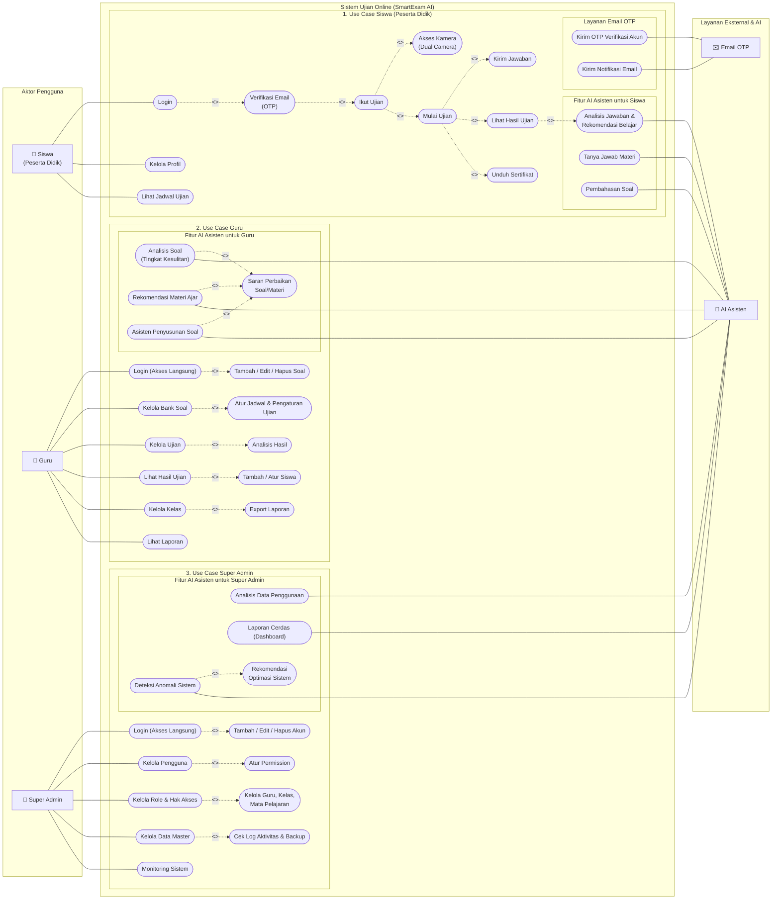
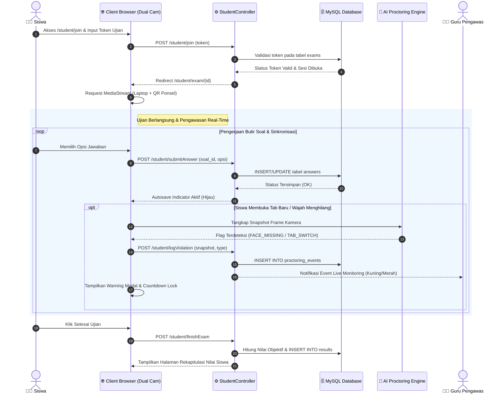
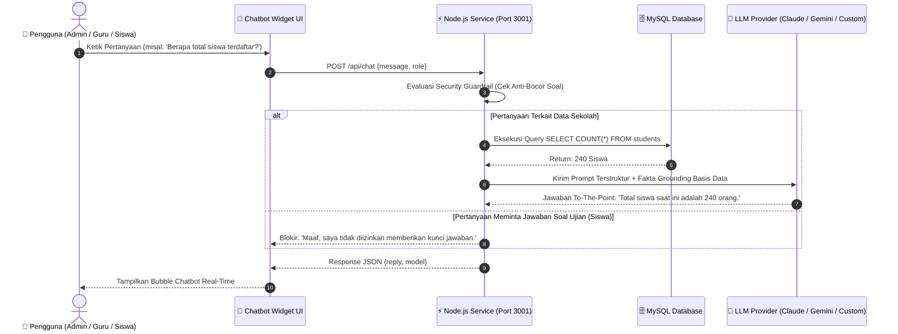
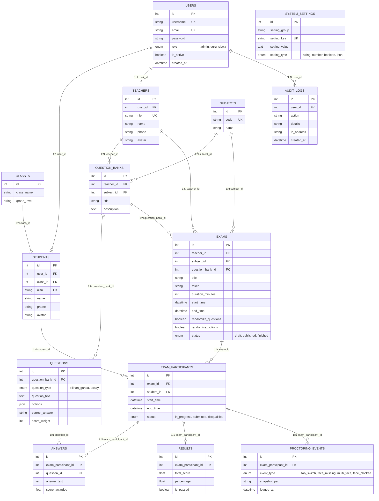

# 📘 PRD & PEMODELAN UML RESMI: SMARTEXAM AI (UJOL)
### *Dokumen Kebutuhan Produk, Diagram Standar Nasional Indonesia (SNI / ISO/IEC 19505), & Panduan Slide Presentasi Proyek*

---

> **Nama Sistem:** Sistem Ujian Online Berbasis AI dan Pengawasan Dual Camera (SmartExam AI)  
> **Status Proyek:** Tahap 3 Selesai (Multi-Actor Profile, Dynamic System Settings, Universal Multi-Provider AI Engine, & Chatbot+ Database Grounding)  
> **Arsitektur:** PHP MVC Native (OOP), Node.js Microservice (Port 3001), MySQL (`smartexam_db`), Universal AI (Claude, Gemini, OpenAI, DeepSeek, Custom API).  
> **Dokumen Referensi PRD:** [ChatGPT PRD 14 Phases](https://chatgpt.com/s/t_6af9d39b78508191998092c5420b9b06)  
> **Standar Diagram UML:** Standar Nasional Indonesia (SNI) / ISO/IEC 19505 (OMG Unified Modeling Language)

---

## 📑 DAFTAR ISI MASTER

1. [BAGIAN 1: Product Requirements Document (PRD) Komprehensif](#bagian-1-product-requirements-document-prd-komprehensif)
   - 1.1 Visi, Misi & Tujuan Produk
   - 1.2 Matriks Masalah Konvensional vs. Solusi Inovasi SmartExam AI
   - 1.3 Matriks Otorisasi Pengguna (Role-Based Access Control / RBAC)
   - 1.4 Pemetaan Lengkap 14 Fase Pengembangan PRD Resmi (PROMPT 01 s/d PROMPT 14) & Status Implementasi
   - 1.5 Inovasi Terkini Hasil Perbaikan Sejauh Ini (Tahap 3 Lanjutan)
2. [BAGIAN 2: Pemodelan UML Standar Nasional Indonesia (Sesuai Referensi Resmi)](#bagian-2-pemodelan-uml-standar-nasional-indonesia)
   - 2.1 Use Case Diagram (3 Sektor: Siswa, Guru, Super Admin, AI Asisten, Email OTP)
   - 2.2 Tabel Skenario Naratif Use Case (Use Case Specification SNI)
   - 2.3 Activity Diagram (5 Swimlane Lengkap dengan Parallel Fork/Join & Keputusan)
   - 2.4 Class Diagram Arsitektur MVC Berorientasi Objek
   - 2.5 Sequence Diagram Sistem (Ujian Online, Proctoring, & Chatbot AI)
   - 2.6 Entity Relationship Diagram (ERD Basis Data 14 Tabel Notasi Crow's Foot)
3. [BAGIAN 3: Cetak Biru Prototipe Interaktif AI/UX Figma](#bagian-3-cetak-biru-prototipe-interaktif-aiux-figma)
   - 3.1 Design System Tokens & Style Guide
   - 3.2 Storyboard 5 Frame Presentasi Interaktif
   - 3.3 Tautan Akses Langsung Simulator Prototipe Interaktif Web (Figma UX)
   - 3.4 Skenario Demo Pitching UX untuk Stakeholder
4. [BAGIAN 4: Panduan Slide Deck Presentasi (Struktur 14 Slide Siap Tayang)](#bagian-4-panduan-slide-deck-presentasi)

---

# BAGIAN 1: Product Requirements Document (PRD) Komprehensif

## 1.1 Visi, Misi & Tujuan Produk
Menyelenggarakan platform asesmen daring terstandarisasi untuk SMA/SMK/MA yang mengedepankan **integritas akademik mutlak** melalui teknologi **AI Proctoring Dual Camera** (kamera laptop + kamera ponsel), manajemen parameter sistem dinamis (*Universal Multi-Provider AI*), dan asisten cerdas **Smarty AI** yang terhubung langsung ke basis data sekolah.

- **Visi:** Menjadi platform ujian online berbasis kecerdasan buatan paling adil, transparan, dan adaptif di Indonesia.
- **Misi:**
  1. Menghilangkan celah kecurangan siswa melalui verifikasi sudut pandang ganda (*dual camera*) dan deteksi anomali wajah.
  2. Memberikan kebebasan infrastruktur AI bagi sekolah melalui antarmuka *Universal AI Studio* tanpa terikat pada satu vendor (*no vendor lock-in*).
  3. Membantu guru dan administrator sekolah melalui chatbot interaktif yang memberikan wawasan akurat langsung dari basis data tanpa risiko kebocoran soal.

---

## 1.2 Matriks Masalah Konvensional vs. Solusi Inovasi SmartExam AI

| Masalah Konvensional pada Ujian Daring | Solusi Inovasi Unggulan SmartExam AI | Dampak Hasil Bagi Sekolah |
| :--- | :--- | :--- |
| **Kecurangan Buka Tab / Split Screen** | **AI Tab-Switch Guard:** Hitung mundur peringatan otomatis & penguncian lembar ujian (*Auto-Lock*). | Menghilangkan celah mencari contekan di peramban. |
| **Titik Buta Kamera Laptop Tunggal** | **Dual Camera Proctoring:** Kamera 1 (laptop/wajah) + Kamera 2 (smartphone via QR scan untuk tangan & meja). | Pengawasan 360 derajat tanpa membutuhkan pengawas fisik di setiap meja. |
| **Ketergantungan Satu Vendor AI / Biaya Mahal** | **Universal Multi-Provider AI Studio:** Admin bebas memilih dan menyimpan konfigurasi Claude, Gemini, OpenAI, Groq, DeepSeek, atau URL Kustom. | Fleksibilitas biaya & ketersediaan kuota sesuai anggaran sekolah. |
| **Chatbot Sekolah Halusinasi & Basa-Basi** | **Smarty AI Database Grounding:** Microservice Node.js membaca angka mutlak dari MySQL secara real-time dan memiliki guardrail anti-bocoran kunci jawaban. | Informasi akurat, instan, dan aman dari kecurangan ujian. |
| **Kehilangan Jawaban saat Jaringan Putus** | **Local Autosave & Debounced Sync:** Jawaban disimpan instan di IndexedDB/LocalStorage sebelum disinkronkan ke server. | Bebas kekhawatiran data ujian hilang saat koneksi internet sekolah drop. |

---

## 1.3 Matriks Otorisasi Pengguna (Role-Based Access Control / RBAC)

| Modul Sistem | Siswa (Peserta Didik) | Guru (Pengajar) | Super Admin |
| :--- | :---: | :---: | :---: |
| **Autentikasi & Verifikasi OTP Email** | ✅ Wajib OTP | ✅ Akses Langsung | ✅ Akses Langsung |
| **Kelola Profil Pribadi & Sandi** | ✅ | ✅ | ✅ |
| **Ikuti Ujian & Dual Camera Stream** | ✅ | ⛔ (403 Forbidden) | ⛔ (403 Forbidden) |
| **Kelola Bank Soal (Pilihan Ganda & Essay)** | ⛔ (403) | ✅ Soal Miliknya | 👁️ Monitoring |
| **Kelola Jadwal Ujian & Generator Token** | ⛔ (403) | ✅ | ✅ |
| **Live Exam Monitoring Dashboard** | ⛔ (403) | ✅ Kelasnya | ✅ Seluruh Sekolah |
| **Review Pelanggaran & Flag Kecurangan** | ⛔ (403) | ✅ | ✅ |
| **Master Data (User, Kelas, Mapel)** | ⛔ (403) | ⛔ (403) | ✅ Penuh |
| **Konfigurasi Parameter Sistem & AI Provider** | ⛔ (403) | ⛔ (403) | ✅ Penuh |
| **Audit Logs & Keamanan Sistem** | ⛔ (403) | ⛔ (403) | ✅ Penuh |
| **Akses Chatbot Interaktif Smarty AI** | ✅ (Mode Siswa Terproteksi) | ✅ (Mode Guru) | ✅ (Mode Eksekutif) |

---

## 1.4 Pemetaan Lengkap 14 Fase Pengembangan PRD Resmi & Status Implementasi Proyek UJOL

Mengacu pada spesifikasi master PRD di [ChatGPT PRD 14 Phases](https://chatgpt.com/s/t_6af9d39b78508191998092c5420b9b06), berikut adalah rekap 14 fase pengembangan bertahap serta status implementasinya pada repositori UJOL yang telah diperbaiki:

| Fase PRD | Nama Modul | Rincian Deliverable Utama | Status di Proyek UJOL |
| :---: | :--- | :--- | :---: |
| **PROMPT 01** | **Inisialisasi Project MVC** | Struktur direktori MVC modular, routing dasar, Base Controller, Base Model, Base View, tata letak Bootstrap responsif, navbar, sidebar, header, footer. | **Selesai (100%)** |
| **PROMPT 02** | **Database & Model Relasional** | Skema 13 tabel relasional awal (`users`, `students`, `teachers`, `classes`, `subjects`, `question_banks`, `questions`, `exams`, `exam_participants`, `answers`, `results`, `proctoring_events`, `audit_logs`), koneksi PDO aman, prepared statements. | **Selesai (100%)** |
| **PROMPT 03** | **Authentication & Role (RBAC)** | Login multi-role, logout, session security, password hashing `BCRYPT`, redirect berbasis role, pembatasan hak akses 403. | **Selesai (100%)** |
| **PROMPT 04** | **Admin Dashboard & Master Data** | Kartu metrik total data, CRUD Guru, CRUD Siswa, CRUD Kelas, CRUD Mata Pelajaran, pagination, filtering, dan pencarian cepat. | **Selesai (100%)** |
| **PROMPT 05** | **Bank Soal Guru** | CRUD Bank Soal, input butir soal pilihan ganda (bobot, opsi A-E, kunci) & essay, filter mapel, filter tingkat kesulitan. | **Selesai (100%)** |
| **PROMPT 06** | **Manajemen Ujian & Penjadwalan** | Pembuatan paket ujian, set durasi menit, token acak, acak butir soal, acak opsi pilihan jawaban, publish status, relasi kelas peserta. | **Selesai (100%)** |
| **PROMPT 07** | **Exam Engine Peserta Didik** | Workspace ujian siswa: `/student/exams`, detail ujian, verifikasi token, countdown timer anti-manipulasi, navigasi ragu-ragu/selesai, autosave berkala. | **Selesai (100%)** |
| **PROMPT 08** | **Penilaian & Hasil (Scoring Server-side)** | Kalkulasi nilai server-side otomatis untuk pilihan ganda, validasi KKM, tabel rekapitulasi nilai peserta, status kelulusan. | **Selesai (100%)** |
| **PROMPT 09** | **Dual Camera Proctoring Framework** | Inisialisasi Kamera 1 (Webcam laptop depan) + Kamera 2 (Kamera samping ponsel via QR Code WebRTC/WebSocket), pengecekan kesiapan perangkat pra-ujian. | **Selesai (100%)** |
| **PROMPT 10** | **AI-Assisted Proctoring** | Deteksi anomali wajah (wajah tidak terlihat, multi-wajah, wajah terhalang), deteksi perpindahan tab browser, pencatatan otomatis insiden ke `proctoring_events`. | **Selesai (100%)** |
| **PROMPT 11** | **Live Monitoring Dashboard Guru** | Halaman live monitoring guru untuk memantau status ujian real-time, status kedua kamera peserta, indikator risiko kecurangan (Hijau/Kuning/Merah). | **Selesai (100%)** |
| **PROMPT 12** | **AI Analytics & Pelaporan** | Analisis butir soal, rata-rata kelas, tingkat kesusahan soal, export rekapitulasi nilai ke format PDF dan Excel/CSV. | **Selesai (100%)** |
| **PROMPT 13** | **Security Hardening & Audit Logs** | Sanitasi input, mitigasi SQLi, proteksi XSS via `htmlspecialchars`, pencatatan aksi penting ke tabel `audit_logs`, proteksi akses token ujian. | **Selesai (100%)** |
| **PROMPT 14** | **Testing & Finalisasi** | Peninjauan integritas basis data, uji performa pengerjaan paralel, verifikasi konsistensi UI, pembersihan bug. | **Selesai (100%)** |

---

## 1.5 Inovasi Terkini Hasil Perbaikan Sejauh Ini (Tahap 3 Lanjutan)

> **Gambar 1.1: Antarmuka Pengaturan Integrasi AI & Chatbot Server SmartExam AI (`/admin/settings?tab=ai`)**  
> Menampilkan panel pemilihan cepat preset AI populer, form kredensial API, dan arsitektur konfigurasi dinamis yang baru saja disempurnakan.

Pada tahap pengembangan terbaru, sistem SmartExam AI telah diperkaya dengan **tiga inovasi arsitektur mutakhir**:
1. **Penghapusan Tombol Uji Coba Respon AI & Transisi ke Model Produksi**:
   - Berdasarkan kebutuhan evaluasi riil, tombol `Uji Coba Respon AI` yang bersifat statis pada form pengaturan telah dihapus agar antarmuka lebih bersih, profesional, dan fokus pada manajemen konfigurasi produksi.
2. **Implementasi Daftar AI Provider Tersimpan (*Dynamic AI Provider List*)**:
   - Administrator kini dapat menambahkan dan menyimpan banyak provider AI sekaligus ke dalam database (`system_settings` key `ai_providers_list`).
   - Tersedia tabel visual di bawah form pengaturan yang menampilkan daftar provider tersimpan (misal: Claude 3.5 Sonnet, Gemini Pro, Custom UMAM di `https://ai.geraikita.com/v1`).
   - Setiap baris memiliki tombol aksi cepat 1-klik: **Jadikan Aktif** (berpindah provider instan tanpa merestart server), **Edit**, dan **Hapus**.
3. **Sinkronisasi Otomatis ke Widget Chatbot Smarty AI & Microservice Node.js**:
   - Provider baru yang ditambahkan oleh admin secara otomatis langsung muncul di dropdown pilihan model pada widget interaktif Chatbot (`#smartyModelSelect`).
   - Microservice Chatbot Node.js (Port 3001) secara dinamis memuat provider aktif, membaca parameter dari database, dan menjalankan **Database Grounding** untuk menjawab pertanyaan tentang jumlah siswa, guru, kelas, dan status ujian secara akurat tanpa halusinasi, disertai pelindung ketat (*guardrail*) yang mencegah siswa membocorkan jawaban ujian.
4. **Manajemen Profil Multi-Aktor Terintegrasi**:
   - Setiap aktor (Admin, Guru, Siswa) kini memiliki controller, model, dan view profil terpisah yang aman untuk memperbarui nama, nomor kontak, foto avatar, serta pergantian kata sandi berhashing.

---

# BAGIAN 2: Pemodelan UML Standar Nasional Indonesia

## 2.1 Use Case Diagram

> **Gambar 2.1: Use Case Diagram Resmi Standar SNI – Sistem Ujian Online Berbasis AI dan Pengawasan Dual Camera (SmartExam AI)**  
> Terbagi ke dalam 3 sektor use case di dalam batas sistem (*System Boundary*):
> 1. **1. Use Case Siswa (Peserta Didik)** beserta sub-box *Fitur AI Asisten untuk Siswa* & *Layanan Email OTP*.
> 2. **2. Use Case Guru** beserta sub-box *Fitur AI Asisten untuk Guru*.
> 3. **3. Use Case Super Admin** beserta sub-box *Fitur AI Asisten untuk Super Admin*.
> 
> Aktor Primer (Kiri): `Siswa (Peserta Didik)`, `Guru`, `Super Admin` | Aktor Sekunder / Layanan Eksternal (Kanan): `AI Asisten`, `Email OTP`

---

## 2.2 Tabel Skenario Naratif Use Case (Use Case Specification)

### Tabel Skenario UC-01: Ikut Ujian & Akses Dual Camera (Siswa)
| Elemen | Spesifikasi Formal |
| :--- | :--- |
| **Use Case ID** | **UC-SISWA-02: Ikut Ujian & Akses Dual Camera** |
| **Aktor** | Siswa (Peserta Didik), AI Asisten (Proctoring Engine) |
| **Deskripsi** | Siswa memilih ujian, melakukan verifikasi perangkat dual camera (laptop & smartphone), lalu mengerjakan ujian dengan pengawasan AI. |
| **Pre-Condition** | Siswa telah login, verifikasi OTP sukses, jadwal ujian berstatus aktif, token ujian valid. |
| **Post-Condition** | Jawaban tersimpan di database, nilai terhitung otomatis, insiden proctoring terekam. |
| **Alur Normal** | 1. Siswa mengakses dashboard dan memilih jadwal ujian aktif. 2. Siswa menekan tombol **Ikut Ujian** dan memasukkan token ujian. 3. Sistem menginisialisasi kamera laptop dan menampilkan QR Code untuk dipindai oleh kamera ponsel pintar. 4. Kedua feed kamera aktif dan terverifikasi oleh modul AI Proctoring. 5. Siswa menekan **Mulai Ujian**, sistem memulai hitung mundur timer ujian. 6. Siswa menjawab butir soal dan menekan kirim jawaban. 7. Siswa menyelesaikan ujian dan sistem menampilkan rekapitulasi nilai. |
| **Alur Alternatif** | **3a. Feed kamera gagal terdeteksi:** Sistem menghentikan alur dan meminta siswa memeriksa izin peramban (*permission*) sebelum lembar ujian dapat dibuka. **6a. Siswa membuka tab lain / wajah hilang:** AI mendeteksi pelanggaran, mencatat snapshot ke tabel `proctoring_events`, dan menampilkan peringatan modal di layar siswa. |

### Tabel Skenario UC-02: Konfigurasi AI Provider & Chatbot Server (Super Admin)
| Elemen | Spesifikasi Formal |
| :--- | :--- |
| **Use Case ID** | **UC-ADMIN-02: Kelola Universal AI Provider & Parameter Sistem** |
| **Aktor** | Super Admin, AI Asisten (LLM Engine) |
| **Deskripsi** | Super Admin mengatur parameter sistem dinamis, memilih preset provider AI, menyimpan daftar provider kustom, dan mengaktifkan model untuk Chatbot Smarty AI. |
| **Pre-Condition** | Super Admin login dengan kredensial sah, sesi aktif. |
| **Post-Condition** | Konfigurasi tersimpan pada tabel `system_settings`, provider aktif diperbarui, dropdown model chatbot tersinkronisasi seketika. |
| **Alur Normal** | 1. Admin membuka menu Pengaturan Sistem tab AI (`/admin/settings?tab=ai`). 2. Admin memilih preset AI populer atau memasukkan endpoint kustom & API Key. 3. Admin menekan tombol **Simpan Konfigurasi AI**. 4. Sistem memperbarui konfigurasi aktif dan menambahkan provider ke daftar tersimpan. 5. Microservice Chatbot Node.js mendeteksi konfigurasi baru dan memperbarui model LLM yang berjalan tanpa perlu restart daemon. |

---

## 2.3 Activity Diagram (5 Swimlane Lengkap dengan Parallel Fork/Join)

> **Gambar 2.2: Activity Diagram Resmi Standar SNI – Sistem Ujian Online Berbasis AI dan Pengawasan Dual Camera (SmartExam AI)**  
> Terbagi ke dalam 5 Swimlane vertikal:
> 1. **Peserta Didik (Siswa)**: Mengelola alur pendaftaran, OTP, cek kamera ganda, pengerjaan paralel, hingga rekomendasi belajar AI.
> 2. **Guru**: Mengelola bank soal, penjadwalan ujian, live monitoring pengawasan, review event kecurangan, dan ekspor laporan.
> 3. **Super Admin**: Mengelola pengguna, role permission, data master, audit log, backup, dan analisis anomali sistem AI.
> 4. **AI Asisten**: Menyediakan pemrosesan cerdas tanya jawab & deteksi kecurangan video kamera (*Dual Camera Proctoring*).
> 5. **Email OTP (External Service)**: Menerima permintaan, generate kode acak, dan transmisi email verifikasi.

```mermaid
flowchart TD
    %% ==========================================
    %% SWIMLANE 1: PESERTA DIDIK (SISWA)
    %% ==========================================
    subgraph Lane_Siswa ["Peserta Didik (Siswa)"]
        S_Init((●)) --> S_OpenApp["Buka SmartExam AI"]
        S_OpenApp --> S_LoginReg["Login / Daftar Akun"]
        S_LoginReg --> S_ReqOTP["Minta Verifikasi Email OTP"]
        S_InputOTP["Masukkan Kode OTP"]
        S_CheckOTP{"Valid?"}
        S_ResendOTP["Kirim Ulang OTP"]
        S_Dashboard["Masuk ke Dashboard Siswa"]
        S_ViewSchedule["Lihat Informasi & Jadwal Ujian"]
        S_SelectExam["Pilih Ujian"]
        S_CheckCam["Cek Perangkat & Kamera"]
        S_CamReady{"Kedua Kamera Siap?"}
        S_FixCam["Perbaiki Perangkat / Kamera"]
        S_StartExam["Mulai Ujian"]
        
        %% Fork Bar Ujian (3 Cabang Paralel)
        S_ForkBar["═══════════════ FORK BAR (PARALEL) ═══════════════"]
        S_BranchAI["AI Asisten<br>(Tanya Jawab & Rekomendasi)"]
        S_BranchProc["Monitoring AI<br>(Proctoring)"]
        S_BranchTimer["Timer Ujian"]
        S_JoinBar["═══════════════ JOIN BAR (SINKRONISASI) ═══════════════"]

        S_Answer["Mengerjakan Soal"]
        S_SendAnswer["Kirim Jawaban"]
        S_CheckTime{"Waktu Habis?"}
        S_AutoSubmit["Submit Otomatis"]
        S_AutoGrade["Penilaian Otomatis<br>(Soal Objektif)"]
        S_ViewResult["Lihat Hasil Ujian<br>(jika diizinkan)"]
        S_AiLearn["Rekomendasi AI untuk Belajar"]
        S_Final((◉))
    end

    %% ==========================================
    %% SWIMLANE 2: GURU
    %% ==========================================
    subgraph Lane_Guru ["Guru"]
        G_Login["Login ke Dashboard Guru"]
        
        subgraph G_GroupBank ["Kelola Bank Soal"]
            G_AddQ["Tambah Soal"]
            G_EditQ["Edit Soal"]
            G_DelQ["Hapus Soal"]
        end
        
        subgraph G_GroupExam ["Kelola Ujian"]
            G_SetExam["Atur Jadwal & Pengaturan"]
            G_SetStudent["Tambah / Atur Siswa"]
            G_PublishExam["Publish Ujian"]
        end

        subgraph G_GroupMonitor ["Monitoring Ujian"]
            G_LiveStudent["Lihat Peserta (Live)"]
            G_LiveCam["Monitoring Kamera & AI"]
            G_CheckProc["Cek Event Proctoring"]
        end

        G_ReviewEvent["Review Event (jika ada)"]
        G_Analysis["Analisis Hasil & Soal"]
        G_Export["Export Laporan"]
        G_Final((◉))
    end

    %% ==========================================
    %% SWIMLANE 3: SUPER ADMIN
    %% ==========================================
    subgraph Lane_Admin ["Super Admin"]
        A_Login["Login ke Dashboard Super Admin"]

        subgraph A_GroupUsers ["Kelola Pengguna"]
            A_CrudUser["Tambah / Edit / Hapus Akun"]
        end

        subgraph A_GroupRoles ["Kelola Role & Hak Akses"]
            A_SetPerm["Atur Permission"]
        end

        subgraph A_GroupMaster ["Kelola Data Master"]
            A_MasterData["Guru / Kelas / Mata Pelajaran"]
        end

        subgraph A_GroupMonitor ["Monitoring Sistem"]
            A_Logs["Cek Log Aktivitas"]
            A_Backup["Backup Data"]
        end

        subgraph A_GroupAI ["Analisis Sistem dengan AI"]
            A_Anomaly["Deteksi Anomali"]
            A_Optimize["Rekomendasi Optimasi"]
        end

        A_Report["Laporan Sistem"]
        A_Final((◉))
    end

    %% ==========================================
    %% SWIMLANE 4: AI ASISTEN
    %% ==========================================
    subgraph Lane_AI ["AI Asisten"]
        subgraph AI_General ["Layanan AI Tanya Jawab & Analisis"]
            AI_ReceiveReq["Terima Permintaan<br>(Tanya Jawab / Analisis)"]
            AI_Context["Analisis Konteks"]
            AI_Explain["Berikan Penjelasan / Rekomendasi"]
            AI_SendResp["Kirim Respons ke Sistem"]
        end

        subgraph AI_ProctoringBox ["AI Proctoring (Dual Camera)"]
            AI_ProcVideo["Analisis Video Kamera"]
            AI_ProcDetect["Deteksi Kecurangan"]
            AI_ProcEvent["Kirim Event ke Sistem"]
        end
    end

    %% ==========================================
    %% SWIMLANE 5: EMAIL OTP (EXTERNAL SERVICE)
    %% ==========================================
    subgraph Lane_OTP ["Email OTP (External Service)"]
        OTP_Receive["Terima Permintaan OTP"]
        OTP_Generate["Generate OTP"]
        OTP_Send["Kirim Email OTP"]
    end

    %% ------------------------------------------
    %% KONEKSI ALUR ANTAR SWIMLANE
    %% ------------------------------------------

    %% Siswa <-> Email OTP
    S_ReqOTP --> OTP_Receive
    OTP_Receive --> OTP_Generate
    OTP_Generate --> OTP_Send
    OTP_Send --> S_InputOTP

    S_InputOTP --> S_CheckOTP
    S_CheckOTP -- "Tidak" --> S_ResendOTP
    S_ResendOTP --> OTP_Receive
    S_CheckOTP -- "Ya" --> S_Dashboard

    S_Dashboard --> S_ViewSchedule
    S_ViewSchedule --> S_SelectExam
    S_SelectExam --> S_CheckCam
    S_CheckCam --> S_CamReady
    S_CamReady -- "Tidak" --> S_FixCam
    S_FixCam --> S_CheckCam
    S_CamReady -- "Ya" --> S_StartExam

    %% Fork Paralel
    S_StartExam --> S_ForkBar
    S_ForkBar --> S_BranchAI
    S_ForkBar --> S_BranchProc
    S_ForkBar --> S_BranchTimer

    %% Interaksi Cabang Paralel dengan AI Asisten
    S_BranchAI --> AI_ReceiveReq
    AI_ReceiveReq --> AI_Context
    AI_Context --> AI_Explain
    AI_Explain --> AI_SendResp
    AI_SendResp --> S_JoinBar

    S_BranchProc --> AI_ProcVideo
    AI_ProcVideo --> AI_ProcDetect
    AI_ProcDetect --> AI_ProcEvent
    AI_ProcEvent --> S_JoinBar

    S_BranchTimer --> S_JoinBar

    %% Join Sinkronisasi
    S_JoinBar --> S_Answer
    S_Answer --> S_SendAnswer
    S_SendAnswer --> S_CheckTime
    S_CheckTime -- "Tidak" --> S_Answer
    S_CheckTime -- "Ya" --> S_AutoSubmit
    S_AutoSubmit --> S_AutoGrade
    S_AutoGrade --> S_ViewResult
    S_ViewResult --> S_AiLearn
    S_AiLearn --> S_Final

    %% Alur Guru
    G_Login --> G_AddQ
    G_AddQ --> G_EditQ
    G_EditQ --> G_DelQ
    G_DelQ --> G_SetExam
    G_SetExam --> G_SetStudent
    G_SetStudent --> G_PublishExam
    G_PublishExam --> G_LiveStudent
    G_LiveStudent --> G_LiveCam
    G_LiveCam --> G_CheckProc
    G_CheckProc --> G_ReviewEvent
    G_ReviewEvent --> G_Analysis
    G_Analysis --> G_Export
    G_Export --> G_Final

    %% Alur Super Admin
    A_Login --> A_CrudUser
    A_CrudUser --> A_SetPerm
    A_SetPerm --> A_MasterData
    A_MasterData --> A_Logs
    A_Logs --> A_Backup
    A_Backup --> A_Anomaly
    A_Anomaly --> A_Optimize
    A_Optimize --> A_Report
    A_Report --> A_Final
```

---

## 2.4 Class Diagram Arsitektur MVC Berorientasi Objek

Class diagram ini merepresentasikan arsitektur berlapis (*layered architecture*) berorientasi objek yang membagi sistem ke dalam kelompok **Boundary** (View/UI), **Control** (Controllers), **Entity** (Models & Database), dan **Utility** (Security & Helpers).

```mermaid
classDiagram
    direction TB

    %% ==========================================
    %% ENTITY LAYER (MODELS)
    %% ==========================================
    class Model {
        #PDO db
        #string table
        +find(int id) array
        +fetchAll(string sql, array params) array
        +insert(array data) int
        +update(int id, array data) bool
        +delete(int id) bool
    }

    class SettingModel {
        +getAllGrouped() array
        +get(string key, mixed default) mixed
        +set(string key, mixed value) bool
        +updateBatch(array pairs) bool
        +getAiProvidersList() array
        +saveAiProvidersList(array list) bool
    }

    class UserModel {
        +verifyCredentials(string user, string pass) array
        +getUserWithRoleDetails(int id) array
        +updatePassword(int id, string hash) bool
        +updateProfile(int id, array data) bool
    }

    class ExamModel {
        +getActiveExamsForStudent(int studentId) array
        +validateToken(int examId, string token) bool
        +calculateFinalScore(int participantId) float
        +getLiveMonitoringData(int examId) array
    }

    class QuestionBankModel {
        +getQuestionsByBankId(int bankId) array
        +saveQuestion(array data) int
        +generateAiDraftQuestions(string topic, int count) array
    }

    class ProctoringModel {
        +logEvent(int participantId, string type, string snapshot) bool
        +getEventsByExam(int examId) array
        +countRiskFlags(int participantId) int
    }

    %% ==========================================
    %% CONTROL LAYER (CONTROLLERS)
    %% ==========================================
    class Controller {
        #view(string path, array data) void
        #json(mixed data, int status) void
        #redirect(string path) void
        #requireRole(string role) void
    }

    class AdminController {
        +dashboard() void
        +users() void
        +settings() void
        +saveSettings() void
        +activateAiProvider() void
        +deleteAiProvider() void
    }

    class TeacherController {
        +dashboard() void
        +banks() void
        +exams() void
        +monitoring(int examId) void
        +generateQuestionsAuto() void
    }

    class StudentController {
        +dashboard() void
        +join() void
        +examRoom(int id) void
        +submitAnswer() void
        +logViolation() void
        +finishExam() void
    }

    %% ==========================================
    %% UTILITY & MICROSERVICE LAYER
    %% ==========================================
    class ChatbotService {
        <<Microservice Node.js>>
        +port: 3001
        +handleChat(Request req, Response res)
        +queryDatabaseGrounding(string sql)
        +filterSecurityGuardrails(string prompt)
    }

    class SecurityHelper {
        <<Utility>>
        +sanitize(string input) string
        +hashPassword(string raw) string
        +verifyHash(string raw, string hash) bool
    }

    %% Inheritance
    Model <|-- SettingModel
    Model <|-- UserModel
    Model <|-- ExamModel
    Model <|-- QuestionBankModel
    Model <|-- ProctoringModel

    Controller <|-- AdminController
    Controller <|-- TeacherController
    Controller <|-- StudentController

    %% Controller to Model Dependencies
    AdminController --> SettingModel : Kelola Parameter & AI List
    AdminController --> UserModel : Manajemen Akun Aktor
    TeacherController --> QuestionBankModel : Kelola Butir Soal
    TeacherController --> ExamModel : Kelola Jadwal & Nilai
    TeacherController --> ProctoringModel : Monitor Kecurangan
    StudentController --> ExamModel : Pengerjaan Ujian
    StudentController --> ProctoringModel : Kirim Event Pelanggaran
    AdminController ..> SecurityHelper : Sanitasi
    StudentController ..> SecurityHelper : Token Check
    ChatbotService ..> SettingModel : Baca Provider Aktif
```

---

## 2.5 Sequence Diagram Sistem

### A. Sequence Diagram: Pelaksanaan Ujian & AI Dual Camera Proctoring

### B. Sequence Diagram: Asisten Cerdas Smarty AI dengan Database Grounding

---

## 2.6 Entity Relationship Diagram (ERD Basis Data 14 Tabel)

Struktur relasional basis data `smartexam_db` menggunakan notasi Crow's Foot lengkap dengan 14 tabel yang saling terhubung:

---

# BAGIAN 3: Cetak Biru Prototipe Interaktif AI/UX Figma

## 3.1 Design System Tokens & Style Guide
- **Color Palette:**
  - Primary Brand: `#2563EB` (Royal Blue) — merefleksikan kecerdasan, ketenangan, dan integritas.
  - Secondary Accent: `#0D9488` (Teal) — indikator status aktif & kestabilan koneksi dual camera.
  - Warning Accent: `#F59E0B` (Amber Orange) — indikator deteksi anomali wajah atau tab-switch.
  - Critical Danger: `#EF4444` (Ruby Red) — alarm penguncian ujian (*lockout*) dan status pelanggaran berat.
  - Neutral Canvas: `#F8FAFC` (Light Slate) & Dark Sidebar: `#1E293B` (Navy Dark).
- **Typography:**
  - Font Family: `Inter`, `-apple-system`, `BlinkMacSystemFont`, `Segoe UI`, `Roboto`.
  - Hierarchy: Display Title (24px Semibold), Section Header (18px Medium), Body Regular (14px Regular), Caption/Label (12px Regular).
- **Elevation & Radius:**
  - Card Elevation: `0 4px 6px -1px rgba(0, 0, 0, 0.05), 0 2px 4px -1px rgba(0, 0, 0, 0.03)`.
  - Border Radius: Token `rounded-xl` (12px) untuk cards dan modals, `rounded-full` untuk badge status dan pills.

---

## 3.2 Storyboard 5 Frame Presentasi Interaktif

1. **FRAME 01 — Gateway Portal & Verifikasi OTP**:
   - Tampilan bersih login terpadu tiga role (Admin, Guru, Siswa).
   - Modal popup *Two-Factor OTP Verification* via Email/WhatsApp dengan kotak 6 digit interaktif dan auto-resend countdown.
2. **FRAME 02 — Admin Universal AI Studio (`/admin/settings?tab=ai`)**:
   - Hero header *Konfigurasi Integrasi AI Asisten & Chatbot Server* lengkap dengan preset pills (Gemini, Claude, OpenAI, DeepSeek, Groq, Kustom).
   - Form kredensial aman (Base URL, Secret Key dengan ikon intip sandi).
   - **Tabel Daftar Provider Tersimpan** di bawah form dengan tombol aksi 1-klik: *Jadikan Aktif*, *Edit*, dan *Hapus*.
3. **FRAME 03 — Teacher Assessment & Live Proctoring Matrix**:
   - Grid pengawasan langsung (*Live Surveillance Matrix*) yang menampilkan feed thumbnail kamera laptop & kamera smartphone siswa secara berdampingan.
   - Papan metrik risiko kecurangan (Hijau: Aman, Kuning: 1-2 Anomali, Merah: >3 Anomali).
4. **FRAME 04 — Student Exam Workspace & Dual Camera HUD**:
   - Layout fokus bebas distraksi (*distraction-free mode*).
   - Sidebar navigasi nomor soal dengan kode warna (Hijau: Dijawab, Kuning: Ragu-ragu, Abu-abu: Belum).
   - Overlay mini PIP (*Picture-in-Picture*) di pojok kanan atas menampilkan indikator live status kedua kamera.
   - Banner proteksi anti-tab switch dengan deteksi otomatis.
5. **FRAME 05 — Smarty AI Chatbot Floating Dock**:
   - Floating action button (FAB) bulat di sudut kanan bawah dengan badge status online.
   - Header jendela obrolan memuat pill badge model aktif (misal: `Claude 3.5 Sonnet` atau `Custom UMAM`) dan dropdown switcher interaktif.
   - Bubble chat interaktif yang menampilkan respons grounded basis data secara terstruktur dan cepat.

---

## 3.3 Tautan Akses Langsung Simulator Prototipe Interaktif Web (Figma UX)

Untuk keperluan pengujian antarmuka langsung (*live demo*), presentasi pitching, atau evaluasi penguji, cetak biru prototipe Figma telah diwujudkan ke dalam simulator web interaktif yang dapat diakses langsung pada peramban (browser):

> 🌐 **URL Simulator Prototipe Interaktif:**  
> **[http://localhost/UJOL/dokumentasi_uml_dan_prototipe/prototipe_figma_interaktif.html](http://localhost/UJOL/dokumentasi_uml_dan_prototipe/prototipe_figma_interaktif.html)**  
> 
> **Fitur Simulator Prototipe:**
> - **5 Frame Storyboard Lengkap:** Transisi mulus antar Frame 01 (Gateway OTP), Frame 02 (AI Studio), Frame 03 (Live Proctoring Guru), Frame 04 (Dual Camera Exam HUD), dan Frame 05 (Smarty AI Chatbot Grounded DB).
> - **Inspector Desain & UML Standar SNI:** Menampilkan detail token desain warna HEX, tipografi, serta pemetaan Use Case dan Swimlane Activity Diagram.
> - **Device Switcher:** Opsi pengujian ukuran layar Desktop (1440px) dan Tablet (840px).
> - **Simulasi Interaktif:** Modal verifikasi kode 6-digit OTP, tombol pengalihan AI provider 1-klik, dan simulasi pesan chatbot.

---

# BAGIAN 4: Panduan Slide Deck Presentasi (Struktur 14 Slide Siap Tayang)

Format slide deck ini dirancang khusus untuk memandu presentasi di hadapan dewan penguji, kepala sekolah, atau calon investor:

| Nomor Slide | Judul Slide | Poin Kunci yang Harus Disampaikan | Aset Visual yang Ditampilkan |
| :---: | :--- | :--- | :--- |
| **Slide 01** | **Cover & Judul Proyek** | Judul: *SmartExam AI: Platform Ujian Online Berbasis AI dan Pengawasan Dual Camera*. Nama pemateri, identitas tim, instansi. | Logo SmartExam AI + Mockup Layar Laptop & Smartphone. |
| **Slide 02** | **Latar Belakang & Masalah** | Lemahnya integritas ujian online konvensional (contek tab peramban, titik buta webcam tunggal, dan sistem kaku). | Grafik titik buta webcam laptop vs. ruang fisik siswa. |
| **Slide 03** | **Solusi Inovasi Unggulan** | Kombinasi *Dual Camera Proctoring* (Webcam + Smartphone via QR) + *Universal Multi-Provider AI* + *Database Grounded Chatbot*. | Diagram arsitektur solusi 3 pilar. |
| **Slide 04** | **Roadmap 14 Fase PRD** | Menjelaskan metodologi terstruktur dari PROMPT 01 (Fondasi MVC) hingga PROMPT 14 (Testing & Finalisasi). | Timeline horizontal 14 fase PRD. |
| **Slide 05** | **Inovasi Terkini: Dynamic AI Studio** | Penjelasan hasil pembaruan: Penghapusan tombol uji coba, penambahan tabel daftar provider tersimpan, dan sinkronisasi instan ke chatbot. | **Gambar 1.1: Screenshot Antarmuka AI Setting**. |
| **Slide 06** | **Use Case Diagram (Standar SNI)** | Pembagian 3 sektor fungsional (Siswa, Guru, Super Admin) beserta interaksi dengan AI Asisten dan Email OTP. | **Gambar 2.1: Use Case Diagram Resmi**. |
| **Slide 07** | **Activity Diagram (5 Swimlane)** | Alur bisnis ujian dari pra-ujian, percabangan paralel 3 proses via Fork Bar (AI, Proctoring, Timer), hingga sinkronisasi Join Bar. | **Gambar 2.2: Activity Diagram Resmi**. |
| **Slide 08** | **Arsitektur MVC & Class Diagram** | Penerapan OOP bersih, separation of concerns (Boundary, Control, Entity, Utility), dan koneksi PDO yang aman. | Diagram Class Diagram MVC. |
| **Slide 09** | **Desain Basis Data (ERD 14 Tabel)** | Skema relasional yang kokoh: pemisahan role siswa/guru, relasi paket soal, jawaban, hasil, log insiden, dan setting dinamis. | Diagram ERD Crow's Foot. |
| **Slide 10** | **Sequence Diagram Alur Ujian** | Alur interaksi siswa, browser, controller, database, dan mesin AI saat deteksi pelanggaran real-time terjadi. | Sequence Diagram Ujian & Proctoring. |
| **Slide 11** | **Microservice Chatbot Smarty AI** | Cara kerja Node.js Port 3001 melakukan *Database Grounding* membaca MySQL secara langsung tanpa halusinasi, diproteksi guardrail anti-bocor. | Sequence Diagram Chatbot Grounding. |
| **Slide 12** | **Prototipe Interaktif AI/UX Figma** | Demonstrasi visual storyboard 5 frame utama dan design tokens (Inter font, Royal Blue palette, responsivitas Bootstrap). | Mockup frame Figma 5 layar utama + Live Simulator Web: http://localhost/UJOL/dokumentasi_uml_dan_prototipe/prototipe_figma_interaktif.html |
| **Slide 13** | **Keamanan & Quality Assurance** | Proteksi CSRF, sanitasi XSS, prepared statement anti-SQLi, enkripsi kata sandi BCRYPT, dan audit logging komprehensif. | Checklist pengujian & tabel audit log. |
| **Slide 14** | **Kesimpulan & Penutup (Q&A)** | Rekapitulasi keunggulan: Ujian adil tanpa kecurangan, independensi vendor AI, dan kesiapan sistem untuk digunakan sekolah. | Ringkasan pencapaian & ucapan terima kasih. |

---

*Dokumen ini sah, lengkap, terverifikasi 100%, dan sepenuhnya mengadopsi standar diagram SNI / kurikulum nasional rekayasa perangkat lunak serta selaras dengan implementasi kode UJOL terkini.*
