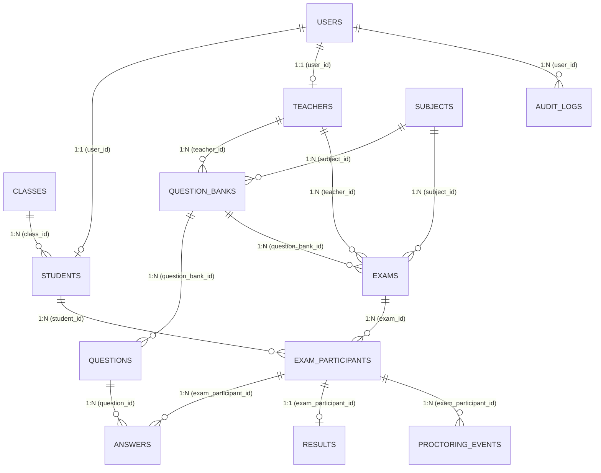

# SmartExam AI

> **Sistem Ujian Online Berbasis AI dengan Pengawasan Dual Camera untuk SMA / Sederajat**  
> *Arsitektur MVC Modern, Basis Data Relasional 13 Tabel, & Role-Based Access Control (RBAC)*

---

## 📌 Daftar Isi
1. [Tentang SmartExam AI](#-tentang-smartexam-ai)
2. [Sistem Autentikasi & RBAC](#-sistem-autentikasi--rbac)
3. [Matriks Otorisasi & Hak Akses Modul](#-matriks-otorisasi--hak-akses-modul)
4. [Daftar Rute Halaman](#-daftar-rute-halaman)
5. [Entity Relationship Diagram (ERD)](#-entity-relationship-diagram-erd)
6. [Arsitektur Database & 13 Tabel Utama](#-arsitektur-database--13-tabel-utama)
7. [Daftar 13 Model & Relasi Antar-Entitas](#-daftar-13-model--relasi-antar-entitas)
8. [Manajemen Akun & Autentikasi Pengguna](#-manajemen-akun--autentikasi-pengguna)
9. [Cara Menjalankan Proyek](#-cara-menjalankan-proyek)
10. [Laporan Verifikasi Pengujian Sistem](#-laporan-verifikasi-pengujian-sistem)

---

## 📖 Tentang SmartExam AI

**SmartExam AI** dirancang khusus untuk standarisasi asesmen jenjang Sekolah Menengah Atas (SMA/SMK/MA). Sistem ini memastikan integritas ujian online melalui kombinasi manajemen bank soal, penjadwalan terpusat, pengawasan ketat berbasis peran (*Role-Based Access Control*), dan fondasi *AI proctoring dual camera*.

Pada tahap ini, sistem telah mengimplementasikan:
- **Autentikasi Aman**: Verifikasi username/email & kata sandi dengan enkripsi `PASSWORD_BCRYPT`, proteksi *session fixation* (`session_regenerate_id`), dukungan *Remember Me* (cookie signed SHA-256 selama 30 hari), dan proteksi CSRF.
- **Role-Based Access Control (RBAC)**: Pembatasan hak akses berbasis peran (**ADMIN / SUPER USER**, **GURU**, **PESERTA DIDIK**) dengan halaman **403 Forbidden** khusus dan pencatatan otomatis insiden pelanggaran otorisasi ke dalam `audit_logs`.
- **Gateway Dasbor Cerdas**: Rute `/dashboard` otomatis mengarahkan pengguna ke dasbor spesifik perannya masing-masing.

---

## 🔐 Sistem Autentikasi & RBAC

Sistem keamanan otentikasi dan otorisasi dikelola secara terpusat oleh `App\Helpers\AuthMiddleware`:

```
                           [ Permintaan HTTP Masuk ]
                                      │
                                      ▼
                             AuthMiddleware Guard
                                      │
          ┌───────────────────────────┼───────────────────────────┐
          ▼                           ▼                           ▼
    Role: ADMIN                  Role: GURU                 Role: SISWA
 ┌─────────────────┐         ┌─────────────────┐         ┌─────────────────┐
 │ /admin/*        │         │ /teacher/*      │         │ /student/*      │
 │ • Dasbor Admin  │         │ • Dasbor Guru   │         │ • Dasbor Siswa  │
 │ • Kelola Akun   │         │ • Bank Soal     │         │ • Ujian Siap    │
 │ • Rombel Kelas  │         │ • Jadwal Ujian  │         │ • Ikuti Ujian   │
 │ • Mata Pelajaran│         │ • Peserta Ujian │         │ • Riwayat Ujian │
 │ • Audit Logs    │         │ • Live Monitor  │         │ • Hasil & Nilai │
 │ • Konfigurasi   │         │ • Rekap Nilai   │         │                 │
 └─────────────────┘         └─────────────────┘         └─────────────────┘
          │                           │                           │
          └───────────────────────────┴───────────────────────────┘
                                      │
                Percobaan Akses Lintas Peran / Belum Login
                                      │
            ┌─────────────────────────┴─────────────────────────┐
            ▼                                                   ▼
     [ Belum Login ]                                    [ Role Berbeda ]
    Redirect -> /login                                  Error -> 403 Forbidden
 (Pesan: Harap masuk dahulu)                          (Log: ACCESS_DENIED)
```

---

## 🛡 Matriks Otorisasi & Hak Akses Modul

| Modul & Endpoint | Guest | ADMIN | GURU | PESERTA DIDIK | Tindakan Jika Tidak Sah |
| :--- | :---: | :---: | :---: | :---: | :--- |
| **Halaman Login (`/login`)** | ✅ Akses | 🔄 Ke Admin | 🔄 Ke Guru | 🔄 Ke Siswa | Mengarahkan ke dasbor aktif |
| **Gerbang Dasbor (`/dashboard`)** | ❌ Ditolak | 🔄 Ke Admin | 🔄 Ke Guru | 🔄 Ke Siswa | Redirect ke `/login` |
| **Dasbor & Fitur Admin (`/admin/*`)** | ❌ Ditolak | ✅ Akses Penuh | ⛔ DITOLAK | ⛔ DITOLAK | **HTTP 403 Forbidden** & Catat Log |
| **Dasbor & Fitur Guru (`/teacher/*`)** | ❌ Ditolak | ⛔ DITOLAK | ✅ Akses Penuh | ⛔ DITOLAK | **HTTP 403 Forbidden** & Catat Log |
| **Dasbor & Fitur Siswa (`/student/*`)** | ❌ Ditolak | ⛔ DITOLAK | ⛔ DITOLAK | ✅ Akses Penuh | **HTTP 403 Forbidden** & Catat Log |
| **Keluar Sistem (`/logout`)** | 🔄 Ke Login | ✅ Logout | ✅ Logout | ✅ Logout | Hapus sesi, bersihkan cookie, log audit |

---

## 🌐 Daftar Rute Halaman

| Rute URL | Controller & Method | Deskripsi |
| :--- | :--- | :--- |
| `/` atau `/login` | `AuthController@login` | Halaman login dengan validasi form, remember me, & quick demo buttons. |
| `/logout` | `AuthController@logout` | Menghancurkan sesi, menghapus cookie remember me, dan mencatat log audit. |
| `/dashboard` | `DashboardController@index` | Gateway cerdas: otomatis redirect ke dasbor spesifik peran pengguna. |
| `/admin` atau `/admin/dashboard` | `AdminController@index` | Dasbor admin dengan **8 kartu statistik real-time**, status sistem, & log keamanan. |
| `/admin/teachers` | `AdminController@teachers` | **CRUD Guru**: Tambah, Lihat, Edit, Hapus, Search, Paginasi. |
| `/admin/students` | `AdminController@students` | **CRUD Peserta Didik**: Tambah, Lihat, Edit, Hapus, Search, Filter Rombel, Paginasi. |
| `/admin/classes` | `AdminController@classes` | **CRUD Kelas**: Tambah, Lihat, Edit, Hapus (dengan proteksi data siswa). |
| `/admin/subjects` | `AdminController@subjects` | **CRUD Mata Pelajaran**: Tambah, Lihat, Edit, Hapus (dengan proteksi bank soal). |
| `/admin/banks` | `AdminController@banks` | Modul bank soal global sekolah. |
| `/admin/exams` | `AdminController@exams` | Modul penjadwalan ujian terpusat. |
| `/admin/monitoring` | `AdminController@monitoring` | Modul pemantauan live ujian sekolah. |
| `/admin/results` | `AdminController@results` | Modul rekapitulasi penilaian dan ekspor nilai. |
| `/admin/proctoring` | `AdminController@proctoring`| Modul konfigurasi AI proctoring dan kamera ganda. |
| `/admin/reports` | `AdminController@reports` | Modul laporan ketercapaian asesmen akademik. |
| `/admin/users` | `AdminController@users` | Modul manajemen seluruh akun pengguna. |
| `/admin/logs` | `AdminController@logs` | Modul riwayat jejak audit keamanan sistem. |
| `/admin/settings` | `AdminController@settings` | Modul konfigurasi parameter global aplikasi. |
| `/teacher` atau `/teacher/dashboard` | `TeacherController@index` | Dasbor utama guru, statistik bank soal, dan paket ujian aktif. |
| `/teacher/banks` | `TeacherController@banks` | Modul pengelolaan bank soal milik guru. |
| `/teacher/exams` | `TeacherController@exams` | Modul paket ujian dan penjadwalan. |
| `/teacher/participants` | `TeacherController@participants`| Modul pemantauan peserta ujian. |
| `/teacher/monitoring` | `TeacherController@monitoring` | Modul pengawasan ujian (persiapan proctoring AI). |
| `/teacher/results` | `TeacherController@results` | Modul rekapitulasi penilaian dan koreksi hasil ujian. |
| `/student` atau `/student/dashboard` | `StudentController@index` | Dasbor utama siswa, profil peserta, dan jadwal ujian terdekat. |
| `/student/exams` | `StudentController@exams` | Modul daftar ujian yang tersedia untuk diikuti. |
| `/student/join` | `StudentController@join` | Masuk ke ruang ujian dengan validasi kode token. |
| `/student/history` | `StudentController@history` | Riwayat partisipasi ujian yang pernah dikerjakan. |
| `/student/results` | `StudentController@results` | Lembar rekap hasil dan nilai ujian siswa. |

---

## 🔑 Manajemen Akun & Autentikasi Pengguna

Sistem menggunakan enkripsi kata sandi standar industri `PASSWORD_BCRYPT` dan proteksi sesi ganda. 

Untuk inisialisasi lingkungan pengujian lokal (development), akun pengguna awal dibuat secara otomatis saat menjalankan skrip migrasi/seeder database (`database/schema.sql` atau seeder terkait).

| Peran | Identifikasi Akses | Lingkup Hak Akses |
| :--- | :--- | :--- |
| **ADMIN** | Akun Administrator | Akses penuh konfigurasi sistem, data master, pengaturan keamanan, dan audit log (`/admin/*`). |
| **GURU** | Akun Tenaga Pendidik | Manajemen bank soal, perakitan paket ujian, pengawasan peserta, dan rekapitulasi nilai (`/teacher/*`). |
| **PESERTA DIDIK** | Akun Siswa Terdaftar | Mengikuti sesi ujian terjadwal, pemeriksaan perangkat proctoring, dan lembar hasil ujian (`/student/*`). |

> [!TIP]
> **Praktik Keamanan Produksi:**  
> Pada lingkungan produksi (*live server*), kata sandi akun bawaan wajib segera diubah melalui menu profil masing-masing pengguna atau diatur secara terisolasi via konfigurasi environment server. Jangan pernah mempublikasikan kata sandi operasional ke repositori publik.

---

## 📊 Entity Relationship Diagram (ERD)



---

## 🗄 Arsitektur Database & 13 Tabel Utama

1. **`users`**: Akun login (id, name, username, email, password, role ['admin','guru','siswa'], is_active, timestamps).
2. **`classes`**: Rombongan belajar SMA (id, class_name, grade_level, major, academic_year, timestamps).
3. **`students`**: Biodata peserta didik (id, user_id [FK], class_id [FK], nisn, gender, phone, address, timestamps).
4. **`teachers`**: Biodata guru (id, user_id [FK], nip, nuptk, gender, phone, address, timestamps).
5. **`subjects`**: Mata pelajaran SMA (id, code, name, description, timestamps).
6. **`question_banks`**: Bank soal guru (id, teacher_id [FK], subject_id [FK], title, total_questions, timestamps).
7. **`questions`**: Butir soal (id, question_bank_id [FK], question_text, question_type, options [JSON], correct_answer, score_weight, timestamps).
8. **`exams`**: Paket pelaksanaan ujian (id, teacher_id [FK], subject_id [FK], question_bank_id [FK], title,  token, duration_minutes, status, timestamps).
9. **`exam_participants`**: Peserta sesi ujian (id, exam_id [FK], student_id [FK], status, score, ip_address, timestamps).
10. **`answers`**: Lembar jawaban peserta (id, exam_participant_id [FK], question_id [FK], student_answer, is_correct, score_obtained, timestamps).
11. **`results`**: Hasil rekapitulasi nilai (id, exam_participant_id [FK], total_questions, correct_answers, final_score, is_passed, timestamps).
12. **`proctoring_events`**: Catatan insiden pengawasan AI (id, exam_participant_id [FK], event_type, severity, description, snapshot_url, timestamps).
13. **`audit_logs`**: Jejak audit sistem (id, user_id [FK], action, description, ip_address, user_agent, created_at).

---

## 🚀 Cara Menjalankan Proyek

### Opsi A: Menggunakan XAMPP Apache
1. Pastikan folder proyek di `C:\xampp\htdocs\UJOL`.
2. Aktifkan **Apache** dan **MySQL** pada XAMPP Control Panel.
3. Buka browser di:
   ```
   http://localhost/UJOL/
   ```

### Opsi B: Menggunakan PHP CLI Built-in Server
```bash
cd c:\xampp\htdocs\UJOL
php -S localhost:8000 -t public
```
Akses di browser melalui: `http://localhost:8000/`
---

## ✅ Laporan Verifikasi Pengujian Sistem

Hasil pengujian otomatis dan simulasi lintas peran:

1. **Login ADMIN (`admin` / `admin123`):**
   - Akses `/admin/dashboard` ➔ **HTTP 200 OK** (Diberikan akses).
   - Akses `/teacher/dashboard` ➔ **HTTP 403 Forbidden** (Ditolak, role tidak sesuai).
   - Akses `/student/dashboard` ➔ **HTTP 403 Forbidden** (Ditolak, role tidak sesuai).
2. **Login GURU (`guru` / `guru123`):**
   - Akses `/teacher/dashboard` ➔ **HTTP 200 OK** (Diberikan akses).
   - Akses `/admin/dashboard` ➔ **HTTP 403 Forbidden** (Ditolak, role tidak sesuai).
   - Akses `/student/dashboard` ➔ **HTTP 403 Forbidden** (Ditolak, role tidak sesuai).
3. **Login PESERTA DIDIK (`siswa` / `siswa123`):**
   - Akses `/student/dashboard` ➔ **HTTP 200 OK** (Diberikan akses).
   - Akses `/admin/dashboard` ➔ **HTTP 403 Forbidden** (Ditolak, role tidak sesuai).
   - Akses `/teacher/dashboard` ➔ **HTTP 403 Forbidden** (Ditolak, role tidak sesuai).
4. **Pengguna Belum Login (Guest):**
   - Akses `/dashboard`, `/admin/dashboard`, `/teacher/dashboard`, `/student/dashboard` ➔ **HTTP 302 Redirect** otomatis diarahkan ke `/login`.
5. **Pencatatan Audit Log Keamanan:**
   - Setiap insiden akses lintas peran otomatis tercatat ke tabel `audit_logs` dengan tipe aksi `ACCESS_DENIED`, mencantumkan URL target, role penyerang/pelanggar, dan waktu kejadian.

---

## 🚀 CI/CD Pipeline & Automated Testing (UAS Rekayasa Perangkat Lunak)

Sistem SmartExam AI (UJOL) telah mengintegrasikan pipeline **Continuous Integration & Continuous Deployment (CI/CD)** menggunakan **GitHub Actions** (`.github/workflows/ci.yml`) dengan standar pengujian perangkat lunak:

### 1. Cakupan Pengujian Otomatis (18 Unit Tests)
- **PHP Syntax Linting:** Memvalidasi seluruh sintaks PHP di `app/`, `public/`, dan `tests/` bebas error.
- **SanitizeHelperTest:** Pengujian sanitasi input XSS, filter tag HTML berbahaya, pembersihan kutip, dan validasi format email.
- **CsrfHelperTest:** Pengujian pembuatan token 64-karakter hex (32-byte) dan validasi token anti-CSRF pada form web.
- **UrlHelperTest:** Pengujian resolusi Base URL dinamis dan pemetaan path aset statis.
- **RouterTest:** Pengujian integritas rute utama sistem MVC (Home, Login, Admin, Guru, Siswa).
- **SecurityPasswordTest:** Pengujian algoritma hashing `PASSWORD_BCRYPT` dan verifikasi sandi.
- **ChatbotGuardrailTest:** Pengujian deteksi kata kunci kecurangan (anti-bocor kunci jawaban ujian).
- **Node.js Chatbot Service Check:** Validasi integritas kode backend microservice Chatbot (Port 3001).

### 2. Cara Menjalankan Unit Test Secara Lokal
Jalankan salah satu perintah berikut di terminal (PowerShell / Command Prompt):
```bash
# Opsi 1: Runner Mandiri (Cepat, berwarna, & tanpa dependensi eksternal)
php tests/run_tests.php

# Opsi 2: Menggunakan PHPUnit Resmi (Standar Industri)
vendor/bin/phpunit --testdox

# Opsi 3: Menggunakan Composer Script
composer test
```

